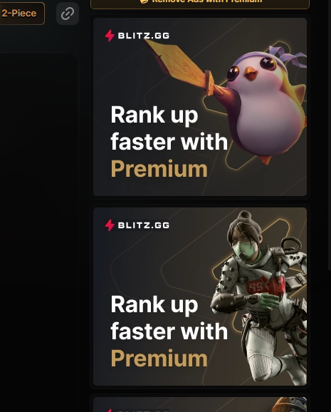
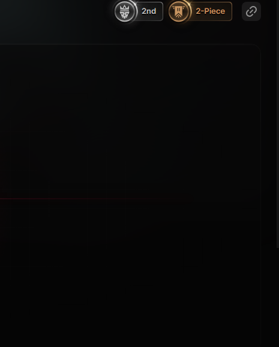
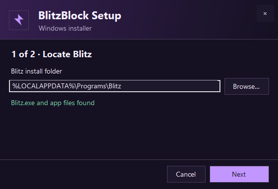

# BlitzBlock

BlitzBlock launches your existing Windows copy of Blitz with fewer ads and Premium promos. It hides known promo cards and reclaims the space they used in the desktop app.

## Install

1. Install [Blitz for Windows](https://blitz.gg/).
2. Download **BlitzBlock Setup.exe** from [Releases](https://github.com/LiamMorganDev/blitzblock/releases/latest).
3. Run setup, confirm your Blitz folder, and choose where to install BlitzBlock. The desktop shortcut is optional.
4. Open **BlitzBlock** from Start. The launcher runs without a terminal.

The installer is unsigned. Windows may show a SmartScreen warning. You can inspect and build the source yourself.

Run setup again to change the Blitz folder or toggle the desktop shortcut. To remove BlitzBlock, use **Settings → Apps → Installed apps → BlitzBlock → Uninstall**, or rerun setup. Your Blitz install and account settings are kept.

## Screenshots

| Blitz before | Blitz through BlitzBlock |
| --- | --- |
|  |  |

Screenshots are cropped to omit account details. The installer path is shown as an environment variable.

## Build and maintain

- [How the launcher works and what we found](docs/HOW_IT_WORKS.md)
- [Build, verify, and update filters](docs/MAINTENANCE.md)

## Scope and license

BlitzBlock is an independent proof of concept for local desktop ad filtering. You install Blitz separately. This project ships its own source and a Node.js runtime in the release installer. It does not ship Blitz executables, app bundles, or extracted assets. The installer derives the Windows shortcut icon locally from your installed copy. Screenshots depict the Blitz interface for documentation.

BlitzBlock leaves account entitlements alone. Blitz and its marks belong to their respective owners. The project is unaffiliated with Blitz. Proof-of-concept status and the project license do not grant rights to third-party software or override applicable terms.

BlitzBlock source is licensed under the [MIT License](LICENSE). The bundled Node.js runtime includes its [own license and notices](https://github.com/nodejs/node/blob/v22.23.5/LICENSE).
